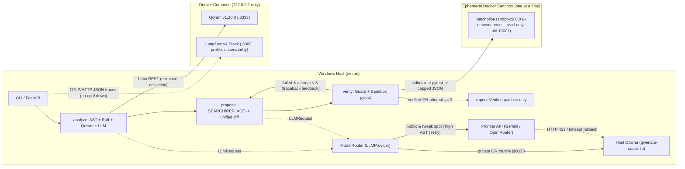

# PatchPilot: Autonomous Code Review & Patch Verification Agent

[](pyproject.toml)
[](uv.lock)
[](src/patchpilot/pipeline/graph.py)
[](sandbox/Dockerfile)
[](src/patchpilot/providers/ollama.py)
[](src/patchpilot/tracing.py)
[](LICENSE)

An autonomous, self-healing code review and patch verification agent engineered in Python 3.11. Given a pull request or repository snapshot, PatchPilot runs static analysis, retrieves repository context from an isolated per-case vector store, generates targeted fixes, executes the project's test suite inside a hardened, zero-network Docker sandbox, and reports **only verified patches** that apply cleanly, pass the failing target test, and introduce zero regressions.

---

## Key Highlights

- **Cyclic LangGraph Repair Pipeline (`analyze → propose ⇄ verify → report`):** Combines Python `ast.parse`, isolated `ruff check --isolated --no-config`, per-case Qdrant vector retrieval, and a bounded retry loop ($k = 3$) that feeds pytest tracebacks back into patch generation while blocking test-file modifications (anti-reward-hacking guard).
- **Dynamic AST Model Router (`ModelRouter`):** Zero-overhead static feature extraction routes routine bugs to local GPU inference (`qwen2.5-coder:7b` via native Windows Ollama at `$0.00` marginal cost) and escalates complex ASTs, known local blind spots (`none_handling`, `sql_injection`), and retry attempts to frontier cloud models (`GeminiProvider` or `OpenRouterProvider` with `google/gemma-4-31b-it:free`). On a 10-case `seeded_train` smoke benchmark (`DECISIONS.md` D-39), routing achieved **10/10 (100.0%)** `pass@1` with **69.81%** cost savings and **49.4%** simulated latency reduction vs. all-frontier. These numbers were simulated using commercial Gemini Flash list prices as a reference baseline (real billing for Gemini free tier and OpenRouter Gemma free tier is `$0.00`); the default frontier provider is OpenRouter (`google/gemma-4-31b-it:free`), but the router benchmark was built against Gemini (commit `c3a95a9`) and has not been measured on Gemma.
- **Fail-Closed Privacy Gate (`SPEC §9`, D-14, D-20):** Every `LLMRequest` defaults to `data_class="private"`. Non-public requests are strictly forced to local host Ollama; any direct non-public call to `GeminiProvider` or `OpenRouterProvider` raises `PrivacyViolationError` (`ProviderError`) before any network request is made.
- **Hardened Docker Verification Sandbox (`SPEC §6`, D-29, D-31):** Ephemeral `docker run --rm` containers enforce `--network none`, `--read-only`, `--user 10001:10001`, `--cap-drop ALL`, `--security-opt no-new-privileges`, `--pids-limit 256`, `--memory 768m`, tmpfs-only `/work` and `/tmp`, a fail-fast cross-process single-run lock (`SandboxBusyError`), and **8/8 hostile fixture containment** (`python -m patchpilot.sandbox selftest`).
- **Cryptographically Frozen Evaluation Suite (`evals/FROZEN.json`):** 480 seeded synthetic cases across 56 distinct templates (14 eval-only / 42 train-only; `eval_templates ∩ train_templates == ∅`) and 8 hostile safety fixtures (verified via `python -m patchpilot.sandbox selftest`). Achieved **105 / 120 (87.5%)** `pass@1` and `pass@3` (`95% Wilson CI: [80.4%, 92.3%]`) evaluated across 120 cases × 3 identical runs (temperature 0; effective $n = 120$) on the frozen `seeded_eval` split (run ID `seeded_eval_ollama_s1_0589c278`, git tag `baseline-seeded-eval-v1`).
- **Real-World Generalization Benchmark (`evals/FROZEN_REALWORLD_MINI.json`):** 14 single-file bug fixes across 9 open-source repositories (`realworld_mini`, git tag `eval-realworld-mini-v1`, `DECISIONS.md` D-43). Baseline evaluation on local Ollama (`qwen2.5-coder:7b`) yielded **0 / 14 (0.0%)** `pass@1` and `pass@3` (`95% Wilson CI: [0.0%, 21.5%]`, small sample), consistent with a synthetic-to-real gap.
- **Automated GitHub PR Review CLI (`patchpilot review`):** Inspects local repositories or live GitHub Pull Requests via plain `httpx` REST calls, emitting GitHub ` ```suggestion ` blocks for sandbox-verified fixes and descriptive risk notes for unverified findings, with strict `GITHUB_TOKEN` redaction.
- **Trace Distillation & QLoRA Colab Pipeline (D-41):** Exports 360 zero-leakage `seeded_train` trajectories in ChatML format (`sha256=610354bbc9db4e98963e652af58bb409453d9e2d4bc8119f94d1636b9470baea`) for a standalone Google Colab T4 4-bit QLoRA notebook (`notebooks/train_qlora_colab.ipynb`) that produces a quantized `q4_k_m` GGUF and Ollama `Modelfile` without adding heavy ML dependencies to `pyproject.toml`.

---

## Architecture Overview

FastAPI, the LangGraph orchestrator, and Ollama run natively on the Windows host (`uv run`). Docker Compose runs only **Qdrant** (core, no profile) and the optional **Langfuse v4** observability stack (`--profile observability`). Sandbox containers are never part of Compose and never receive the Docker socket; they are launched one at a time by the host orchestrator via `docker run --rm`.



### Process Boundaries & Pipeline Nodes (`src/patchpilot/pipeline/`)

1. **`analyze` (`nodes.py`):** Runs `ast.parse` and `ruff check --output-format json --isolated --no-config` in an isolated temporary directory (never loading target-repo configs on the host), indexes the repository into an isolated per-case Qdrant collection (`patchpilot_case_<sha256[:16]>`), and queries `LLMProvider` for fault localization. Ground-truth files (`patch.diff`, `meta.json`) are never read on real provider paths (`D-35`).
2. **`propose` (`nodes.py`, `normalization.py`):** Prompts the model for `<<<<<<< SEARCH:<file>` / `=======` / `>>>>>>> REPLACE` blocks (or unified diffs) and normalizes them against the in-memory repository snapshot via `difflib.unified_diff`. Enforces the **anti-reward-hacking guard**: any patch touching `test_*.py`, `*_test.py`, `tests/**`, `conftest.py`, or any non-`.py` file is rejected immediately.
3. **`verify` (`nodes.py`, `sandbox/runner.py`):** Re-validates the reward-hacking guard (defense in depth) and streams the repository snapshot + unified diff over `stdin` into a fresh hardened `patchpilot-sandbox:0.0.0` container. If verification fails while `attempt < 3`, the pipeline follows the conditional retry edge `verify → propose` with the pytest failure summary and increments the attempt counter (`pass@1` on attempt 1; `pass@3` within $\le 3$ attempts).
4. **`report` (`nodes.py`):** Emits structured findings and outputs `reported_patch` **only** when `verified == True` (`patch_applies and target_test_passes and regressions == 0`).

---

## Empirical Results & Benchmarks

All accuracy, cost, and runtime figures reported below are produced by recorded evaluation runs or deterministic benchmark tests in accordance with `AGENTS.md` Rule 8.

### 1. Frozen Baseline Evaluation on `seeded_eval` (`baseline-seeded-eval-v1`)

Evaluated across the cryptographically frozen `seeded_eval` split (`evals/FROZEN.json`, SHA-256 `d39534c5de1f39017efaafdaab0178fe98ba4a2c3ad1b5643500ec78d65d6c31`) containing **$N = 120$ distinct cases** across **14 eval-only structural templates** (2 reserved templates per bug class across 7 classes; zero template or hash overlap with `seeded_train`). Executed for $n_{\text{runs}} = 3$ complete passes at `seed=1` with `prompt_version_hash=ca774b4a6efb4c2384a6f216439068326840bd10ec0543a1032f135bc0f20782`:

| Pool | Model (`LLMProvider`) | Distinct Cases ($N$) | Runs ($n$) | `pass@1` | `pass@3` | 95% Wilson CI | Recorded Run ID & Artifacts |
|---|---|---|---|---|---|---|---|
| `seeded_eval` (Baseline, D-38) | `qwen2.5-coder:7b` (`ollama`) | 120 cases × 3 identical runs (temperature 0; effective $n=120$) | 3 | **105 / 120 (87.5%)** | **105 / 120 (87.5%)** | **[80.4%, 92.3%]** | `seeded_eval_ollama_s1_0589c278` (`evals/results/seeded_eval_ollama_s1_0589c278_run{1,2,3}.json`, tag `baseline-seeded-eval-v1`) |
| `seeded_eval` (Track B, `master`, D-48) | `qwen2.5-coder:7b` (`ollama`) | 120 cases × 3 runs (360 total obs) | 3 | **287 / 360 (79.7%)** | **305 / 360 (84.7%)** | **[75.3%, 83.6%]** (`pass@1`) / **[80.6%, 88.1%]** (`pass@3`) | `seeded_eval_ollama_trackb_s1` (`evals/results/seeded_eval_ollama_trackb_s1_run{1,2,3}.json`) |

#### Statistical Comparator (`distillation compare` Baseline vs. Track B Candidate)

Automated comparison via `python -m patchpilot.distillation compare --baseline seeded_eval_ollama_s1_0589c278 --candidate seeded_eval_ollama_trackb_s1`:

| Metric | Baseline (`seeded_eval_ollama_s1_0589c278`) | Candidate (`seeded_eval_ollama_trackb_s1`) | Delta |
|---|---|---|---|
| Model | `qwen2.5-coder:7b` | `qwen2.5-coder:7b` | — |
| Runs (`n_runs`) | 3 (360 obs) | 3 (360 obs) | — |
| `pass@1` (95% Wilson CI) | 315/360 (87.5%) [83.7%, 90.5%] | 287/360 (79.7%) [75.3%, 83.6%] | -7.78 pp |
| `pass@3` (95% Wilson CI) | 315/360 (87.5%) [83.7%, 90.5%] | 305/360 (84.7%) [80.6%, 88.1%] | -2.78 pp |
| Avg Latency / Case | 16.727s | 13.167s | -3.560s (-21.3% faster) |
| Estimated API Cost | $0.000000 | $0.000000 | $+0.000000 |

> [!NOTE]
> **Statistical Scope:** Evaluated across 120 cases × 3 identical runs (temperature 0; effective $n = 120$). Each of the 3 runs (`run1`: 2002.1 s, `run2`: 2092.5 s, `run3`: 1927.0 s) produced the exact same 105/120 verified fixes (315/360 total executions). Because repeated runs at temperature 0 evaluate the same 120 cases rather than 360 independent cases, confidence intervals are reported at the true effective sample size $n = 120$ per run (`[80.4%, 92.3%]`), and generalization is bounded by the 14 reserved eval templates.

#### Per-Class Taxonomy Breakdown (`seeded_eval_ollama_s1_0589c278`, per run $N = 120$)

| Bug Taxonomy Class | Distinct Cases ($n$) | `pass@1` | `pass@3` | 95% Wilson Confidence Interval | Notes |
|---|---|---|---|---|---|
| `bad_default_arg` | 17 | **100.0%** (17/17) | **100.0%** (17/17) | `[81.6%, 100.0%]` | Mutable default arguments (`=[]`, `={}`) |
| `missing_await` | 17 | **100.0%** (17/17) | **100.0%** (17/17) | `[81.6%, 100.0%]` | Unawaited coroutine calls in `async def` |
| `off_by_one` | 18 | **100.0%** (18/18) | **100.0%** (18/18) | `[82.4%, 100.0%]` | Boundary `<` vs `<=` and slice index errors |
| `resource_leak` | 17 | **100.0%** (17/17) | **100.0%** (17/17) | `[81.6%, 100.0%]` | Unclosed file/stream handles without context managers |
| `wrong_operator` | 17 | **100.0%** (17/17) | **100.0%** (17/17) | `[81.6%, 100.0%]` | Arithmetic/boolean operator inversions |
| `sql_injection` | 17 | **70.6%** (12/17) | **70.6%** (12/17) | `[46.9%, 86.7%]` | String-formatted SQL vs. `?` parameterized tuples (routed to frontier in Phase 6) |
| `none_handling` | 17 | **41.2%** (7/17) | **41.2%** (7/17) | `[21.6%, 64.0%]` | Explicit `None` attribute/dict chains (routed to frontier in Phase 6) |
| **Total (`seeded_eval`)** | **120** | **87.5% (105/120)** | **87.5% (105/120)** | **`[80.4%, 92.3%]`** | Run ID `seeded_eval_ollama_s1_0589c278` |

---

### 2. Dynamic Model Router Smoke Benchmark (`DECISIONS.md` D-39)

`ModelRouter` (`src/patchpilot/router/`) extracts static AST and prompt signals (`ast_node_count`, `max_ast_depth`, `non_test_file_count`, `estimated_prompt_tokens`, retry state, and taxonomy weak-spot patterns) before every LLM call. Routine requests stay on local Ollama (`$0.00` marginal API cost); tasks matching local weak spots (`none_handling`, `sql_injection`), high AST complexity (`ast_node_count >= 80`, `max_ast_depth >= 10`, `non_test_file_count >= 3`, or `estimated_prompt_tokens >= 1200`), or cascade retry (`is_retry == True` on attempt $\ge 2$) escalate to the configured frontier provider (`PP_FRONTIER_PROVIDER=openrouter|gemini`).

On the deterministic **10-case `seeded_train` smoke benchmark** (`seeded_train/0001..0010`, verified in `tests/test_router.py::test_router_smoke_benchmark_10_seeded_train_cases`, `DECISIONS.md` D-39). The 69.81% cost savings and 49.4% latency reduction were simulated using commercial Gemini Flash list prices (`$0.10 / 1M` prompt tokens, `$0.40 / 1M` completion tokens) as a reference baseline; real billing for both the Gemini free tier and OpenRouter Gemma free tier is `$0.00`. The default frontier provider is OpenRouter (`google/gemma-4-31b-it:free`), but this smoke benchmark was built against Gemini (commit `c3a95a9`) and has not been measured on Gemma:

| Routing Strategy | `pass@1` ($n=10$) | Local Calls (Ollama 7B) | Frontier Calls | Estimated API Cost | Simulated Latency | Cost Savings vs. All-Frontier |
|---|---|---|---|---|---|---|
| **All-Local (`OllamaProvider`)** | 7 / 10 (70.0%) | 100% | 0% | `$0.0000000` | `6.5s` | — |
| **All-Frontier (simulated Gemini Flash list pricing)** | 10 / 10 (100.0%) | 0% | 100% (20/20) | `$0.0014792` | `17.0s` | Baseline (`0.0%`) |
| **`ModelRouter` (`CascadeConfidencePolicy`)** | **10 / 10 (100.0%)** | **14 / 20 (70.0%)** | **6 / 20 (30.0%)** | **`$0.0004466`** | **`8.6s`** | **69.81% savings** (`49.4%` lower simulated latency) |

- **Resiliency & Auto-Fallback:** When the frontier API raises `ProviderError` (such as HTTP 429 rate-limit exhaustion or network timeout), `ModelRouter` catches the failure, falls back to local Ollama without aborting the pipeline, sets `fallback_used = True`, and attaches `warning_flag="frontier_fallback:rate_limit_429:..."` or `"frontier_fallback:network_timeout:..."` to the Langfuse OTLP generation span at `WARNING` level.
- **OpenRouter & Gemma 4 Support (`D-42`, `D-48`):** `OpenRouterProvider` (`src/patchpilot/providers/openrouter.py`) connects to `https://openrouter.ai/api/v1/chat/completions` (default model `google/gemma-4-31b-it:free`) via plain `httpx` and enforces the identical `data_class == "public"` privacy gate. In an empirical probe (`--pool seeded_train --provider router --runs 1 --seed 43 --limit 3 --run-id seeded_train_router_openrouter_probe_s43_limit3`), OpenRouter's `google/gemma-4-31b-it:free` returned upstream `HTTP 429` rate limits from `Google AI Studio`. `ModelRouter` recorded `local_calls=8`, `frontier_calls=0`, and `fallback_count=6`, attaching upstream 429 warnings to Langfuse spans and falling back gracefully to local Ollama without aborting the pipeline (`pass@1 = 2/3 (66.7%)`, `D-48`). A local non-regression run on `seeded_train` after Track B (`seeded_train_ollama_trackb_s43_limit30`, `limit=30`, `seed=43`, `prompt_version_hash=ca774b4a6efb8c2384a6f216439068326840bd10ec0543a1032f135bc0f20782`) scored **29 / 30 (96.7%)** `pass@1` & `pass@3` (`[83.3%, 99.4%]`).

---

### 3. Prompt Tuning Progression (`seeded_train` Only — Not an Eval Result, `D-38`)

In compliance with `AGENTS.md` Rule 12, all prompt engineering was conducted exclusively on `seeded_train` subsets ($n = 60$) before touching `seeded_eval`:

| Iteration (`seeded_train`, $n=60$) | Seed | `prompt_version_hash` (prefix) | `pass@1` | `pass@3` | 95% Wilson CI (`pass@1`) | Recorded Run ID |
|---|---|---|---|---|---|---|
| Baseline (pre-tuning) | 7 | `f3e461d61db4` | 35 / 60 (58.3%) | 39 / 60 (65.0%) | `[45.7%, 69.9%]` | `seeded_train_ollama_s7_1132a601` |
| Round 1 (strict `SEARCH:` delimiters, no 3rd-party imports) | 17 | `1f0b17fa0d4c` | 43 / 60 (71.7%) | 44 / 60 (73.3%) | `[59.2%, 81.5%]` | `seeded_train_ollama_s17_e1a7e2f0` |
| Round 2 (no outer code fences, `?` SQL tuples, `dict.get` note) | 29 | `a16d55560e35` | 49 / 60 (81.7%) | 49 / 60 (81.7%) | `[70.1%, 89.4%]` | `seeded_train_ollama_s29_62fd0d31` |
| **Round 3 (`prompts-v1`, full-file `SEARCH/REPLACE` guidance)** | **43** | **`ca774b4a6efb`** | **49 / 60 (81.7%)** | **49 / 60 (81.7%)** | **`[70.1%, 89.4%]`** | **`seeded_train_ollama_s43_e3d54b4e`** |

---

### 4. Real-World Evaluation Check (`realworld_mini`) & Limitations

To test generalization beyond synthetic templates, we curated `realworld_mini`, a frozen benchmark pool of **14 single-file bug fixes across 9 pure-Python open-source repositories** (SHA-256 frozen in `evals/FROZEN_REALWORLD_MINI.json`, git tag `eval-realworld-mini-v1`, `DECISIONS.md` D-43).

| Benchmark Pool | Provider & Model | Distinct Cases ($N$) | Runs ($n$) | `pass@1` | `pass@3` | 95% Wilson CI | Recorded Run ID & Status |
|---|---|:---:|:---:|:---:|:---:|:---:|---|
| **`realworld_mini` (Baseline)** | `qwen2.5-coder:7b` (`ollama`) | 14 | 1 | **0 / 14 (0.0%)** | **0 / 14 (0.0%)** | **`[0.0%, 21.5%]`** | `realworld_mini_ollama_s1_e267146f` (tag `eval-realworld-mini-v1`, D-43) |
| **`realworld_mini` (Experimental Branch)** | `qwen2.5-coder:7b` (`ollama`) | 14 | 1 | 1 / 14 (7.1%) | 1 / 14 (7.1%) | `[1.3%, 31.5%]` | Branch `experimental/realworld-pipeline-refinements` (commit `f4cb255`, D-44) |
| **`realworld_mini` (Track B, `master`)** | `qwen2.5-coder:7b` (`ollama`) | 14 | 3 | **3 / 42 (7.1%)** | **3 / 42 (7.1%)** | **`[2.5%, 19.0%]`** | `realworld_mini_ollama_trackb_s1` (runs 1..3, `D-47`, `D-48`) |

> [!IMPORTANT]
> **Limitations & Empirical Findings:**
> 1. **Synthetic-to-Real Domain Gap:** The drop from **87.5% (105/120)** baseline / **79.7% (287/360)** Track B on synthetic templates to **0.0% (0/14)** baseline / **7.1% (3/42 across 3 runs)** Track B on real-world repositories is the primary empirical finding of this work. While local 7B models succeed on small synthetic single-function templates (< 50 lines), failure analysis on `realworld_mini` (D-43, D-48) shows that across both baseline and Track B (4-tier AST-guarded `SEARCH/REPLACE` normalization and AST symbol context slicing, `D-47`), local 7B zero-shot repair on multi-hundred-line codebases remains bounded by incorrect or unnormalizable patch edits. In Track B `realworld_mini_ollama_trackb_s1` (3 runs × 14 cases = 42 observations), case `0001` (`dacite:dacite/cache.py`) verified 100% across all 3 runs on attempt 1, and total prompt tokens/runtime dropped by **70.5%** (`744,194` -> `219,642` on run 1) and **57.4%** (`4,242.0s` -> `1,806.0s` on run 1), while remaining cases either failed sandbox tests or failed normalization.
> 2. **Post-Hoc Experimental Branch:** The experimental branch `experimental/realworld-pipeline-refinements` (commit `f4cb255`, D-44) introduces a Tier-2 resilient matcher and stack-trace file filtering that passed 1 case after post-hoc tuning (0005, `jsonpointer`, `pass@1 = True`). However, these heuristics were developed and tuned post-hoc after inspecting the baseline failure modes on `realworld_mini`; this is **not a held-out evaluation result** and a 1/14 vs 0/14 difference is not statistically distinguishable (confidence intervals overlap fully).
> 3. **Simulated Router Savings:** The cost savings (69.81%) and simulated latency reductions (49.4%) reported for `ModelRouter` were evaluated on a 10-case smoke benchmark of synthetic fixtures (`DECISIONS.md` D-39) using commercial Gemini Flash list prices as a reference baseline; real billing for both the Gemini free tier and OpenRouter Gemma free tier is `$0.00`. The default frontier provider is OpenRouter (`google/gemma-4-31b-it:free`), but the router benchmark was built against Gemini (commit `c3a95a9`) and has not been measured on Gemma; these numbers do not reflect live production traffic or live API billing calls.
> 4. **Prompt Tuning Reflects Format Compliance:** The progression from 58.3% to 81.7% on `seeded_train` reflects prompt compliance (strict `SEARCH/REPLACE` delimiters without markdown backticks) rather than improved underlying algorithmic reasoning.
> 5. **Mocked PR Review & Un-trained QLoRA:** GitHub PR integration (`patchpilot review`) has been tested against offline fixtures and mock providers only; live PR posting has not been executed on production repositories. The QLoRA distillation pipeline (`data/distillation_train.jsonl`, `notebooks/train_qlora_colab.ipynb`) is fully implemented with verified zero eval leakage, but no fine-tuned model has been trained or evaluated yet.
> 6. **Training-Data Contamination Risk:** The 9 open-source repositories are popular public projects; their source code and test suites may have been present in pre-training data for `qwen2.5-coder:7b`.

---

### 5. Rebuilding & Attributions for `realworld_mini`

The raw repository files in `evals/datasets/realworld_mini` are gitignored to avoid vendoring third-party source trees. The pool can be deterministically reproduced on the host and verified against the cryptographic manifest:

```powershell
# 1. Fetch parent commits on host and verify test failure/pass transitions in Docker
uv run --frozen python -m patchpilot.evals build-realworld-mini

# 2. Verify dataset integrity against the cryptographic freeze manifest
uv run --frozen python -m patchpilot.evals verify-frozen-realworld-mini
```

#### Upstream Repository Attributions

The 14 cases in `realworld_mini` are derived from the following permissively licensed open-source projects:

| Project | Cases | License | Upstream Repository |
|---|:---:|---|---|
| **dacite** | 2 | MIT | [konradhalas/dacite](https://github.com/konradhalas/dacite) |
| **schema** | 1 | MIT | [keleshev/schema](https://github.com/keleshev/schema) |
| **jsonpointer** | 2 | BSD-3-Clause | [stefankoegl/python-json-pointer](https://github.com/stefankoegl/python-json-pointer) |
| **parse** | 2 | MIT | [r1chardj0n3s/parse](https://github.com/r1chardj0n3s/parse) |
| **docopt-ng** | 2 | MIT | [jazzband/docopt-ng](https://github.com/jazzband/docopt-ng) |
| **python-semver** | 2 | BSD-3-Clause | [python-semver/python-semver](https://github.com/python-semver/python-semver) |
| **tabulate** | 1 | MIT | [astanin/python-tabulate](https://github.com/astanin/python-tabulate) |
| **mistune** | 1 | BSD-3-Clause | [lepture/mistune](https://github.com/lepture/mistune) |
| **tinydb** | 1 | MIT | [msiemens/tinydb](https://github.com/msiemens/tinydb) |

---

## Security Architecture, Privacy & Hardening

PatchPilot treats the PR author, LLM outputs, and target repository test suites as **untrusted** (`SPEC §6`). Untrusted patches and tests are never executed on the host.

### Hardened Defense-in-Depth Matrix

| Defense Vector | Enforcement & Configuration | Verified Evidence |
|---|---|---|
| **Network Isolation** | `--network none` on every verification container; zero outbound sockets, LAN access, or DNS resolution. | `network_egress` fixture contained against ephemeral host TCP listener (`python -m patchpilot.sandbox selftest`); mutation test verifies failure when weakened (`tests/test_sandbox.py`). |
| **Privilege & Capability Drop** | `--user 10001:10001 --cap-drop ALL --security-opt no-new-privileges`, default seccomp profile, no Docker socket mount. | `read_host_env` and privilege mutation tests (`tests/test_sandbox.py`). |
| **Filesystem Isolation** | `--read-only` root filesystem; writable mounts restricted to `--tmpfs /work:rw,nosuid,size=256m,uid=10001,gid=10001` and `--tmpfs /tmp:rw,noexec,nosuid,size=128m`. | `write_outside_work` and `disk_fill` fixtures contained (`8/8` in `sandbox selftest`). |
| **Process, Memory & Time Caps** | `--pids-limit 256`, `--memory 768m --memory-swap 768m --cpus 1`, hard 120 s wall-clock timeout (`docker kill` + `docker rm -f`), cross-process + thread single-run lock (`SandboxBusyError`). | `fork_bomb`, `memory_balloon` (exit 137/247 or `MemoryError`), `infinite_loop`, and `PASS single-run lock` (`sandbox selftest`). |
| **Archive & Patch Bounds** | `build_repo_tar` sets `follow_symlinks=False`; `safe_extract_tar` rejects symlinks, hardlinks, special files, drive/absolute paths, and `..` traversal. Capped at 10,000 tar members, 32 MB/file, 200 MB unpacked, 10 MB patch. | `symlink_escape` fixture contained; unit tests in `tests/test_sandbox.py`. |
| **Untrusted XML Defense** | Host **never** parses untrusted JUnit XML (`ET.fromstring` is absent from `src/`). Container entrypoint reads $\le 1\text{ MB}$, rejects `<!DOCTYPE` and `<!ENTITY`, and emits a JSON summary capped at 500 cases validated by Pydantic on the host (`D-31`). | `tests/test_sandbox.py` XML entity/cap tests; AST grep verification. |
| **Dependency Install Isolation** | Optional network-enabled install step mounts only `patchpilot-deps-<sha256>` and runs `pip install --only-binary :all: --no-build-isolation --no-input --target /deps` with **zero repo files or build hooks**, then mounts `/deps:ro` into the `--network none` container. | `PASS install step runs no repo code` (`sandbox selftest`). |
| **Anti-Reward-Hacking Guard** | Rejects any patch modifying `test_*.py`, `*_test.py`, `tests/**`, `conftest.py`, or non-`.py` files at both normalization (`normalize_patch`) and verification (`verify`). | `tests/test_pipeline.py` reward-hacking regression suite (`D-35`). |
| **Fail-Closed Privacy Gate** | `LLMRequest.data_class` defaults to `"private"`. `ModelRouter` forces non-public requests to local Ollama; `GeminiProvider` and `OpenRouterProvider` raise `PrivacyViolationError` on non-public requests. Private GitHub repos (`base.repo.private == True`) automatically set `data_class="private"`. | `tests/providers/` and `tests/test_router.py` privacy contract suite. |
| **Secret & Token Redaction** | Minimal environment passed to `docker` CLI; `GITHUB_TOKEN`, `PP_GEMINI_API_KEY`, `PP_OPENROUTER_API_KEY`, and Langfuse secrets are redacted as `***REDACTED***` across `__repr__`, `__str__`, and error messages. | `tests/test_review.py`, `tests/providers/`, `src/patchpilot/config.py`. |
| **Localhost Port Binding** | All Compose ports (`127.0.0.1:6333` Qdrant, `127.0.0.1:3000`/`3030` Langfuse, `127.0.0.1:9090` MinIO) and host Ollama (`127.0.0.1:11434`) bind exclusively to loopback. | `.\tasks.ps1 config` and `docker-compose.yml` inspection. |
| **Static Security Audit** | Zero occurrences of `shell=True`, `eval()`, `exec()`, `pickle`, `yaml.load()`, or `ET.fromstring` in `src/`. Bandit `1.9.4` scan (`uvx bandit -r src sandbox -ll`) reports **0 High-severity issues** across 11,291 lines of code (only Medium findings outside deliberate `taxonomy.py`/`fixtures.py` test payloads are Docker `--tmpfs /tmp:...` flag strings and the container-internal `ET.fromstring` guarded by `<!DOCTYPE`/`<!ENTITY` rejection). | Verified via `Select-String` AST/pattern audit and `uvx bandit -r src sandbox -ll` (2026-11-07). |

> [!WARNING]
> **Known Limitation — Shared WSL2 Kernel (`SPEC §6`, D-17):** Hardened Docker containers share the Linux kernel of the Docker Desktop WSL2 VM with other containers (Qdrant, Langfuse). A kernel or runtime vulnerability could allow hostile code to escape into the WSL2 VM. PatchPilot v1 accepts this risk for ordinary untrusted PRs; do not run it against nation-state or purposefully weaponized kernel exploits without upgrading the runtime boundary to **gVisor (`runsc`)** or a disposable VM.

---

## Quickstart Guide (Windows 11 & Linux/CI)

### Prerequisites
- **OS & Hardware:** Windows 11 (tested on 16 GB RAM + NVIDIA RTX 8 GB VRAM GPU) or Linux. Allow the WSL2 VM $\ge 6\text{ GB}$ RAM (e.g., `memory=6GB` in `%UserProfile%\.wslconfig`).
- **Docker Desktop:** Running with the WSL2 backend.
- **[uv](https://docs.astral.sh/uv/):** Python `3.11.*` and exact `==` dependencies from `uv.lock` are fetched automatically.
- **[Ollama](https://ollama.com):** Installed **natively on the Windows host** (never inside Docker) for direct GPU acceleration:
  ```powershell
  ollama pull qwen2.5-coder:7b
  ```

### Installation & Setup

```powershell
# 1. Clone the repository
git clone https://github.com/ahmedantarAi/PatchPilot.git
cd PatchPilot

# 2. Create your local environment configuration (never committed)
Copy-Item .env.example .env

# 3. Sync pinned Python 3.11 environment and register src/ path (.pth)
.\tasks.ps1 setup

# 4. Build the hardened sandbox image (patchpilot-sandbox:0.0.0)
.\tasks.ps1 sandbox-build

# 5. Start core vector store (Qdrant on 127.0.0.1:6333, 512 MB limit)
.\tasks.ps1 up
```

*(On Linux/macOS/CI where `make` is available, `make setup`, `make sandbox-build`, `make up`, `make check`, and `make config` provide the exact same commands as `.\tasks.ps1`.)*

### Environment Configuration (`.env`)

All settings are validated via `pydantic-settings` in `src/patchpilot/config.py` (see `.env.example` for full defaults):

```ini
# Core provider selection: ollama | gemini | openrouter | mock | router
PP_LLM_PROVIDER=mock

# Frontier provider used by ModelRouter: openrouter | gemini
PP_FRONTIER_PROVIDER=openrouter

# Native host Ollama (default model: qwen2.5-coder:7b)
PP_OLLAMA_BASE_URL=http://localhost:11434
PP_OLLAMA_MODEL=qwen2.5-coder:7b

# OpenRouter free-tier frontier model (PUBLIC/SYNTHETIC CODE ONLY — SPEC §9; default frontier in config.py)
PP_OPENROUTER_API_KEY=
PP_OPENROUTER_MODEL=google/gemma-4-31b-it:free
PP_OPENROUTER_BASE_URL=https://openrouter.ai/api/v1

# Google Gemini free-tier frontier model (PUBLIC/SYNTHETIC CODE ONLY — SPEC §9)
# Model name matches .env.example (gemini-3.6-flash; earlier planning notes cited gemini-3.8-flash)
PP_GEMINI_API_KEY=
PP_GEMINI_MODEL=gemini-3.6-flash
```

For live GitHub PR reviews (without `--dry-run`), export `GITHUB_TOKEN` in your shell environment (`$env:GITHUB_TOKEN="ghp_..."`).

---

## CLI Usage Reference

### 1. Run the Sandbox Containment Selftest (Phase 2)
Verify all 8 hostile fixtures, the cross-process single-run lock, and the zero-repo-code dependency install step:
```powershell
.\tasks.ps1 sandbox-build
uv run --frozen python -m patchpilot.sandbox selftest
```
Expected output:
```text
PASS contained: network_egress
PASS contained: read_host_env
PASS contained: fork_bomb
PASS contained: disk_fill
PASS contained: infinite_loop
PASS contained: memory_balloon
PASS contained: write_outside_work
PASS contained: symlink_escape
PASS single-run lock
PASS install step runs no repo code
SANDBOX SELFTEST: 8/8 contained
```

### 2. Run the Autonomous Repair Pipeline on a Case (Phase 4)
Materialize the deterministic datasets (if not already present in `evals/datasets/`, which is gitignored) and run the LangGraph pipeline:
```powershell
uv run --frozen python -m patchpilot.evals build --seed 1337
uv run --frozen python -m patchpilot.evals verify-frozen
uv run --frozen python -m patchpilot run --provider mock --case seeded_eval/0001
```
Output (single-line JSON summary, works both when Qdrant is up and when Qdrant is down):
```json
{"case":"seeded_eval/0001","provider":"mock","patch_applies":true,"target_test_passes":true,"regressions":0,"verified":true}
```
Swap `--provider mock` for `--provider ollama`, `--provider router`, `--provider openrouter`, or `--provider gemini`.

### 3. Review a Local Repository or GitHub Pull Request (Phase 7)
Analyze a local repository fixture or a live GitHub Pull Request, verify candidate patches inside the sandbox, and format GitHub review comments:
```powershell
# Offline dry-run against the bundled PR fixture
uv run --frozen python -m patchpilot review --repo-dir tests/fixtures/pr_demo --dry-run --provider mock
```
Output:
```text
findings=2 verified_patches=1 comments_posted=0 (dry-run)
```
To review a remote GitHub PR (dry-run or live):
```powershell
uv run --frozen python -m patchpilot review --repo owner/repo --pr 42 --dry-run --provider router --out review_report.json
```

### 4. Run the Dynamic Model Router Smoke Benchmark (Phase 6)
Execute the 9 router contract tests and the 10-case `seeded_train` cost/latency smoke benchmark:
```powershell
uv run --frozen pytest tests/test_router.py -q
```

### 5. Langfuse v4 Observability & Trace Smoke Test (Phase 5)
Start the optional 6-container Langfuse v4 observability stack (requires replacing `CHANGEME` secrets in `.env`), verify OTLP trace ingestion, and confirm graceful no-op degradation when stopped:
```powershell
.\tasks.ps1 obs-up
uv run --frozen python -m patchpilot trace-smoke
.\tasks.ps1 obs-down
uv run --frozen python -m patchpilot trace-smoke
```
Expected output: `trace_id=<32 hex> visible=true` when up, and `tracing disabled: no-op` (exit 0) when down.

### 6. Run Resumable Evaluation Benchmarks & Compare Runs (Phases 3, 5 & 8)
```powershell
# Verify frozen split integrity and run an evaluation pass with atomic per-case checkpoints
uv run --frozen python -m patchpilot.evals run --pool seeded_eval --provider ollama --runs 3 --seed 1

# Compare baseline vs. candidate runs (requires >= 3 runs each and matching prompt_version_hash)
uv run --frozen python -m patchpilot.distillation compare --baseline seeded_eval_ollama_s1_0589c278 --candidate <candidate_run_id>
```

---

## Trace Distillation & QLoRA Fine-Tuning (Phase 8)

PatchPilot keeps `pyproject.toml` lean and reproducible on a 16 GB host by excluding heavy training dependencies (`torch`, `transformers`, `peft`, `bitsandbytes`, `unsloth`). Instead, training data is exported locally and fine-tuned on a free Google Colab T4 GPU:

1. **Export Verified Training Trajectories (`seeded_train` only):**
   ```powershell
   uv run --frozen python -m patchpilot.distillation export-train --output data/distillation_train.jsonl
   ```
   Output:
   ```text
   exported 360 seeded_train samples to data/distillation_train.jsonl sha256=610354bbc9db4e98963e652af58bb409453d9e2d4bc8119f94d1636b9470baea (train/eval overlap=0)
   ```
   `validate_case_zero_leakage` enforces that zero samples come from `seeded_eval`, zero templates belong to the 14 reserved eval templates, and zero content/source/diff hashes or mutation signatures overlap `evals/FROZEN.json`.
2. **Fine-Tune on Google Colab T4 (`notebooks/train_qlora_colab.ipynb`):**
   - Open `notebooks/train_qlora_colab.ipynb` in Google Colab with a free T4 GPU runtime (16 GB VRAM) and upload `data/distillation_train.jsonl`.
   - Fine-tunes `Qwen/Qwen2.5-Coder-7B-Instruct` via Unsloth + TRL `SFTTrainer` in 4-bit NF4 (`load_in_4bit=True`, `max_seq_length=2048`, LoRA `r=16`, `lora_alpha=32`, `lora_dropout=0.0`, `per_device_train_batch_size=2`, `gradient_accumulation_steps=4`, `learning_rate=2e-4`, `num_train_epochs=3`, `optim="adamw_8bit"`).
   - Exports a quantized `q4_k_m` GGUF and an Ollama `Modelfile`.
3. **Register & Evaluate in Local Ollama:**
   ```powershell
   ollama create patchpilot-qwen2.5-coder:7b-qlora -f Modelfile
   ```
   Both baseline and fine-tuned models run through `OllamaProvider` and are compared via `python -m patchpilot.distillation compare`.

---

## Resource Budget (16 GB Host RAM / 6 GB WSL2 Ceiling)

| Component | Memory Limit / Measured Footprint | Notes |
|---|---|---|
| **Qdrant (`v1.20.0`, core)** | `mem_limit: 512m` (`90.2 MiB` measured active) | Only service started by `.\tasks.ps1 up` |
| **Langfuse v4 Stack (`observability` profile)** | `mem_limit: 4096m` across 6 containers (`2168.5 MiB` measured active) | `langfuse-web` (1280m), `clickhouse` (1280m), `worker` (768m), `postgres` (384m), `minio` (256m), `redis` (128m) |
| **Total Docker Compose Budget** | **`4608 MB` configured** ($\le 6144\text{ MB}$ ceiling; **`2258.7 MiB` measured active**) | Verified in `SPEC §8` and `DECISIONS.md` D-36 |
| **Ephemeral Verification Sandbox** | `768 MB` RAM / `1 CPU` / `256 PIDs` (sequential, 1 container at a time) | Peak container RAM with `obs-up` is $\approx 3.01\text{ GiB}$, well inside the 6 GB WSL2 limit |
| **Host Ollama (`qwen2.5-coder:7b`)** | `~76.8 MB` host RAM working set (`~4.7 GB` Q4_K_M weights in 8 GB GPU VRAM) | Keep `OLLAMA_NUM_PARALLEL=1` and `OLLAMA_MAX_LOADED_MODELS=1` |

---

## Project Structure

```text
PatchPilot/
├── .github/workflows/ci.yml    # GitHub Actions CI (ruff, mypy, pytest with mock provider, compose config)
├── data/                       # Exported ChatML distillation datasets (gitignored)
├── evals/                      # Evaluation benchmark suite & frozen split manifest
│   ├── FROZEN.json             # Cryptographic SHA-256 freeze manifest for seeded_eval & safety
│   ├── FROZEN_REALWORLD_MINI.json # Cryptographic freeze manifest for realworld_mini pool
│   ├── datasets/               # Materialized case pools (gitignored; built via `evals build --seed 1337`)
│   └── results/                # Committed baseline JSON reports (`seeded_eval_ollama_s1_0589c278_run*.json`)
├── notebooks/
│   └── train_qlora_colab.ipynb # Standalone Google Colab T4 4-bit QLoRA training & GGUF export notebook
├── sandbox/
│   ├── Dockerfile              # Hardened Python 3.11 sandbox image (non-root 10001:10001, no repo code)
│   └── runner.py               # In-container entrypoint: safe tar extract, unified diff apply, capped JUnit JSON
├── src/patchpilot/             # Application source (run via PYTHONPATH / .venv patchpilot.pth)
│   ├── distillation/           # Zero-leakage ChatML exporter (`exporter.py`) & run comparator (`compare.py`)
│   ├── evals/                  # 56-template generator, sandbox verifier, freeze guard, resumable runner
│   ├── pipeline/               # LangGraph state machine (`analyze -> propose <-> verify -> report`)
│   ├── providers/              # `LLMProvider` protocol + Ollama, Gemini, OpenRouter, and Mock implementations
│   ├── review/                 # GitHub REST client (`httpx`), PR suggestion formatter, and `review` runner
│   ├── router/                 # AST feature extractor, static/cascade policies, fallback router, telemetry
│   ├── sandbox/                # Host `docker run` orchestrator, tar/diff safety, and 8 hostile fixtures
│   ├── __main__.py             # CLI entrypoint (`run`, `review`, `trace-smoke`)
│   ├── api.py                  # FastAPI host service (`.\tasks.ps1 api`)
│   ├── config.py               # Pydantic v2 settings and credential redaction
│   ├── retrieval.py            # Per-case Qdrant REST client and `Embedder` protocol (`Ollama` / `Hash`)
│   └── tracing.py              # Langfuse v4 OTLP/HTTP tracer and dataset run synchronization
├── tests/                      # 125 offline unit/integration tests + 22 live/Docker containment tests
├── AGENTS.md                   # Mandatory engineering & evaluation integrity rules
├── DECISIONS.md                # Architectural decision log (D-01 through D-48)
├── PLAN.md                     # Phase 0–8 acceptance contracts and verification outputs
├── SPEC.md                     # System specification, threat model, and resource budget
├── docker-compose.yml          # Pinned Qdrant (core) and Langfuse v4 (`observability` profile) definitions
├── Makefile                    # Linux/macOS/CI task runner (kept in sync with `tasks.ps1`)
├── pyproject.toml              # Exact `==` pinned dependencies, ruff, mypy, and pytest configuration
├── tasks.ps1                   # Windows PowerShell task runner
└── uv.lock                     # Locked dependency graph
```

---

## Development & Verification

Before finishing any change, run the full static analysis, type-checking, unit test, and Docker Compose validation suite (`AGENTS.md` Rule 10):

```powershell
.\tasks.ps1 check     # ruff check . + ruff format --check . + mypy src + pytest -q (125 passed)
.\tasks.ps1 config    # validates docker-compose.yml with and without --profile observability
```

Optional pre-commit hook (runs pinned `ruff` without adding dependencies to `pyproject.toml`, `D-19`):
```powershell
uvx pre-commit@4.7.0 install
```

---

## License

This project is licensed under the MIT License — see the [LICENSE](LICENSE) file for details.
